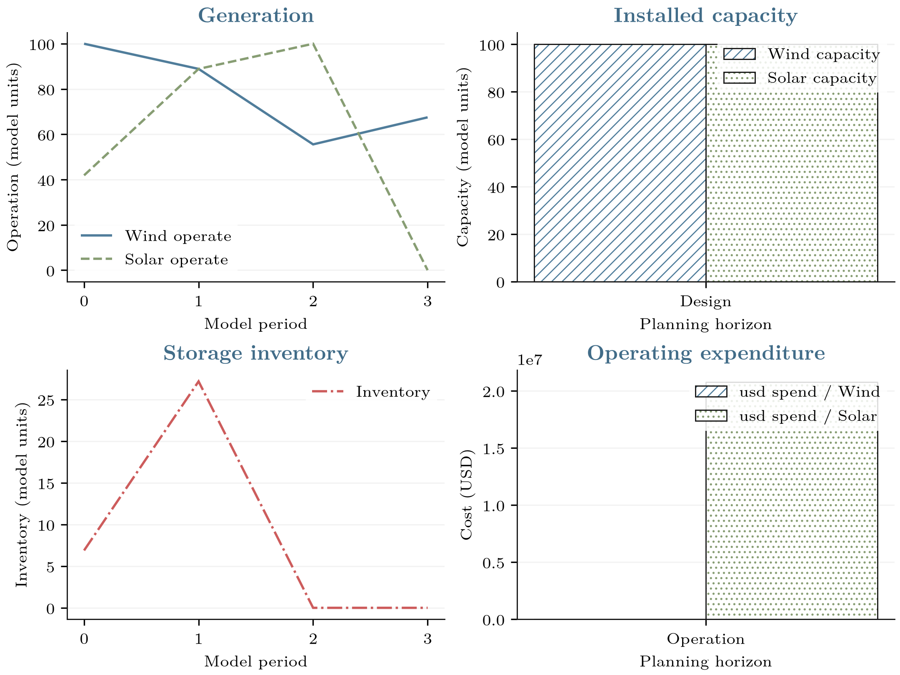

Manuscript plots
================

Energia selects physical results; Gana constructs and renders every chart.
The default Gana theme supplies typography, line styles, patterned fills and
legends. Energia has no separate theme or Matplotlib renderer.

.. code-block:: python

   from energia.library.examples.energy import scheduling

   m = scheduling()
   m.usd.spend.opt()
   dispatch = m.wf.operate(m.q).line()
   dispatch.save("dispatch.pdf", profile="print", fig_size=(3.5, 2.5))

The sample must select an existing result domain. When several domains match,
select the location, period scale and related activity explicitly. A coarse
total and its detailed quantities are never combined implicitly. An unknown
selection or unavailable solution raises an error without declaring variables.
``n_sol=0`` selects the first stored solution; ``n_sol=1`` selects the second.
Each description captures its values before any subsequent solve.

Construction and composition
----------------------------

Samples, aspects and models share Gana's ``line``, ``scatter``, ``bar``,
``stacked``, ``area``, ``band`` and ``errorbar`` methods. Aspects require exactly
one registered domain; use an aspect's ordinary selection call otherwise.

.. code-block:: python

   wind = m.wf.operate(m.q)
   demand = m.power.release(m.q)
   plot = m.bar(wind, demand)
   equivalent = wind.bar() + demand.bar()
   mixed = wind.bar() + demand.line()
   result = mixed.render()
   figure, axes, data = result.figure, result.axes, result.data

``+`` overlays quantities. Gana checks coordinate identity and units; grouped
and stacked values must share the same ordered coordinates. Independent lines
can use different slices of the same time scale. Unitless/unknown records remain
explicitly unspecified. A label override does not convert physical units.

.. code-block:: python

   from gana.plotting import column

   flow = m.power.produce(m.q, m.wf.operate).line()
   cost = m.usd.spend(m.q, m.wf.operate).bar()
   figure = column(flow, cost, sharex=True)
   figure.save("flow-and-cost.svg", profile="print", fig_size=(3.5, 5.0))

Use separate panels for incompatible units or quantities. ``band`` accepts
supplied ``lower`` and ``upper`` arrays or single-series samples; ``errorbar``
accepts ``xerr`` and ``yerr`` deviations. ``scatter(x=other_sample)`` plots a
selected quantity against another with matching coordinates. These operations
do not estimate uncertainty.

Time and physical meaning
-------------------------

The complete temporal tuple is flattened into ordered model-period positions,
including multiple containing periods. ``m.wf.operate(m.q[1::2]).line()`` retains
positions 1 and 3. These are model coordinates, not inferred calendar dates.
Representative periods remain representative; no chronology is reconstructed.
Other varying coordinates, including operating modes, produce distinct series.

Values are copied from the selected Gana solution. Energia does not integrate
rates, multiply occurrence weights, sum inventories/capacities, add hierarchy
totals, apply conversion coefficients again or reconstruct cost contributions.
Declared commodity/operation bases supply units when available. A basis alone
does not establish a per-hour rate. Supply a precise ``ylabel`` for the study's
quantity and retain its modeled basis. Missing values remain missing, not zero.

``energia.plotting.records(sample, n_sol=0)`` returns Gana ``Series`` records
for reuse with Gana's public plotting functions. Each record retains the source
sample, time coordinates, selected result number, label and declared unit.
Automatic dispatch reconciliation, aggregation, heatmaps and RTN diagrams are
outside this initial binding layer.

Publication export
------------------

``save`` supports vector PDF/SVG and raster PNG. ``fig_size`` is in inches;
``profile="print"`` uses Gana's print typography and ``dpi`` controls raster
resolution. The example widths of 3.5 inches for one column and 7.2 inches for
a full-width figure are working sizes, not journal requirements. Check the
intended publisher's dimensions before final export.

PDFs use the bundled Latin Modern outlines with Type 3 embedding. If a publisher
requires Type 1/TrueType text, use a compatible font/TeX export setup and inspect
the resulting PDF; changing ``pdf.fonttype`` alone does not convert the bundled
OpenType/CFF fonts into TrueType. SVG defaults to outlined text for portability; use
``rc={"svg.fonttype": "none"}`` when editable text is required, with the matching
font available at the destination. Caller Matplotlib settings are restored.

The gallery retains the bundled example's model units and inputs. Reproduce it
and individual PDF/SVG/300-dpi PNG figures, together with the plotted values::

   python tools/plotting_gallery.py /tmp/energia-figures

The old ``Sample.line()``/``bar()`` calls now return descriptions: use ``show()``
for immediate display, ``render()`` for axes or ``save()`` for export. Existing
positional style arguments remain accepted. ``Model.draw(sample)`` still displays
immediately; multiparametric ``Model.draw()`` retains Gana's region plotting.
